# 飞书合同审查机器人

**把合同提交、四职能审查、版本复审和任务跟进，连成一条群内协作流程。**

[](https://github.com/ericli-88/feishu-contract-review-bot/actions/workflows/ci.yml)


面向服务方视角的合同辅助审查工具。在飞书群里 `@机器人 + 文档链接`，或回复合同附件并 `@机器人`，从**商务、运营、法务、财务**四个视角给出建议，通过持续复用的飞书任务保留每版审查历史。最终判断与完成确认由负责人作出。

> **图片说明**：以下为模拟飞书客户端的功能场景图，使用虚构人员、合同和链接。卡片文字来自项目真实工作流及格式化函数，飞书服务和 AI 由内存适配器替代，图片不是线上执行截图。运行 `pnpm demo` 可复现卡片数据。

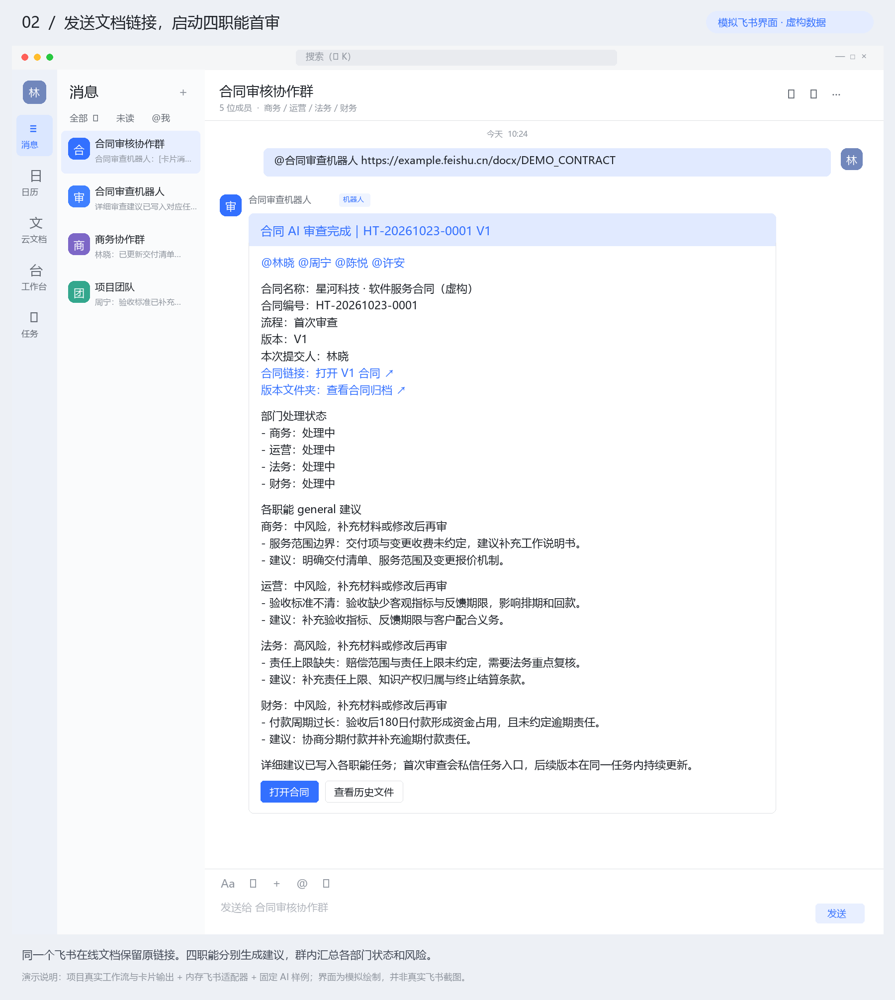

[快速开始](#快速开始) · [功能与飞书场景](#功能与飞书场景) · [支持范围](#支持范围) · [架构](#架构) · [验证记录](docs/VERIFICATION.md) · [版本来源](docs/PROVENANCE.md)

## 快速开始

### 安装与离线验收

需要 **Node.js 22 或 24**、**pnpm 11.9.0**。首次安装 pnpm 可运行 `npm install -g pnpm@11.9.0`。

```sh
git clone https://github.com/ericli-88/feishu-contract-review-bot.git
cd feishu-contract-review-bot
pnpm install --frozen-lockfile
pnpm typecheck
pnpm test
pnpm demo
```

`pnpm test` 验证解析、首审与复审、附件抽取、任务复用、状态权限、事件去重、迁移与 HTTP 回调认证。`pnpm demo` 使用临时状态目录跑通 11 个场景，生成 [`docs/demo/scenes.json`](docs/demo/scenes.json)，不需要 `.env` 或 API 凭证。

### 配置真实运行环境

Windows PowerShell 运行 `Copy-Item .env.example .env`；macOS / Linux 运行 `cp .env.example .env`。在本地 `.env` 填入：

```dotenv
FEISHU_APP_ID=cli_your_app_id
FEISHU_APP_SECRET=your_app_secret
FEISHU_VERIFICATION_TOKEN=your_verification_token
# 启用加密回调时填写开放平台中的 Encrypt Key
FEISHU_ENCRYPT_KEY=
FEISHU_BOT_MENTION_NAME=合同审查机器人
FEISHU_CONTRACT_CHAT_ID=oc_your_group_id

AI_API_KEY=your_api_key
AI_BASE_URL=https://api.openai.com/v1
AI_MODEL=your_available_model
```

使用通用 `AI_*` 时将 `ARK_*` 留空。使用火山方舟时填写 `ARK_API_KEY`、`ARK_BASE_URL`、`ARK_VISION_MODEL`；`ARK_*` 优先。模型或接入点应以服务账号中实际可用的配置为准。

负责人可在群里注册，也可固定配置；多人使用英文逗号分隔：

```dotenv
OWNER_COMMERCIAL_NAMES=商务甲,商务乙
OWNER_COMMERCIAL_USER_IDS=user_id_1,user_id_2
OWNER_OPERATIONS_USER_IDS=user_id_3
OWNER_LEGAL_USER_IDS=user_id_4
OWNER_FINANCE_USER_IDS=user_id_5
FEISHU_DOCUMENT_ARCHIVE_ENABLED=true
FEISHU_TASKS_ENABLED=true
```

**数据处理**：合同正文发送到配置的 AI 服务商；归档逻辑会尝试设置原在线文档为组织内可编辑，并授权合同群访问归档文件夹。请按组织要求决定是否开启，详见 [安全说明](SECURITY.md)。

### 启动与回调

```sh
pnpm build
pnpm start
```

默认端口 `3000`，`GET http://127.0.0.1:3000/healthz` 返回 `{"ok":true}`；开发时用 `pnpm dev`。

项目使用 **HTTP Webhook 回调**。飞书开放平台启用机器人、订阅 `im.message.receive_v1`，事件请求地址填写 `https://你的公网域名/feishu/events`。配置权限后发布应用，把机器人加入目标群，并授权读取测试文档。详见 [安装配置](docs/SETUP.md) 和 [生产部署](docs/PRODUCTION_DEPLOYMENT.md)。

## 功能与飞书场景

### 1. 负责人注册与身份识别

`@合同审查机器人 我是商务负责人` 将当前用户注册到对应职能。`我是谁` 查看群与用户标识，`帮助` 返回指令；单人试用可用 `我是全部负责人`。生产环境建议固定四职能 `user_id`。

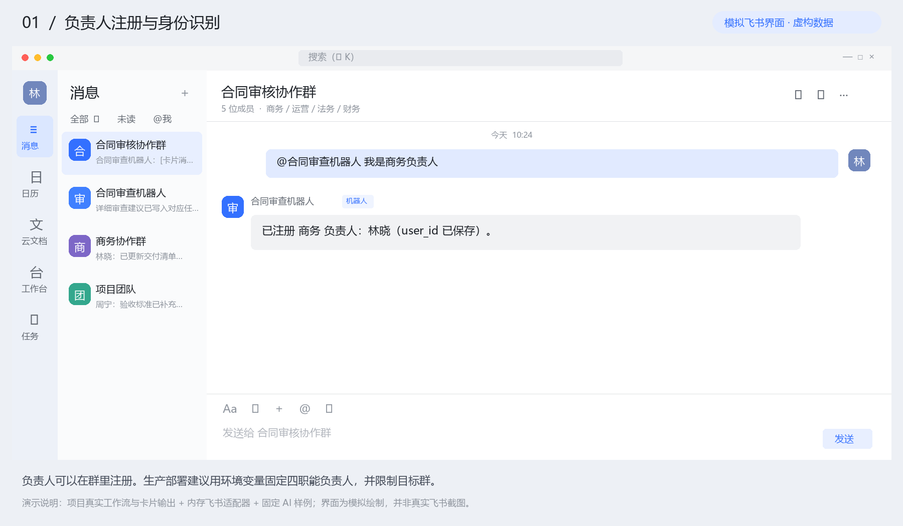

### 2. 文档链接触发四职能审查

发送 `@合同审查机器人 https://example.feishu.cn/docx/DEMO_CONTRACT`。支持 `docx`、旧版 `docs`、`wiki` 与富文本中的真实链接。各职能独立输出风险和修改动作，群总览保留原合同链接、部门状态与风险汇总。**首屏场景图展示此流程。**

商务／运营关注履约、范围、变更和验收；法务关注责任、知识产权、数据与终止；财务关注收款、账期、质保金和逾期责任。规则见 [审查参考资料](.claude/skills/clinical-contract-review/references)。

### 3. 负责人私信与任务入口

V1 私信各职能负责人对应入口卡片，详细建议写入职能任务。多人可以共同负责同一职能任务。按钮由实际可用的 URL 决定是否显示。

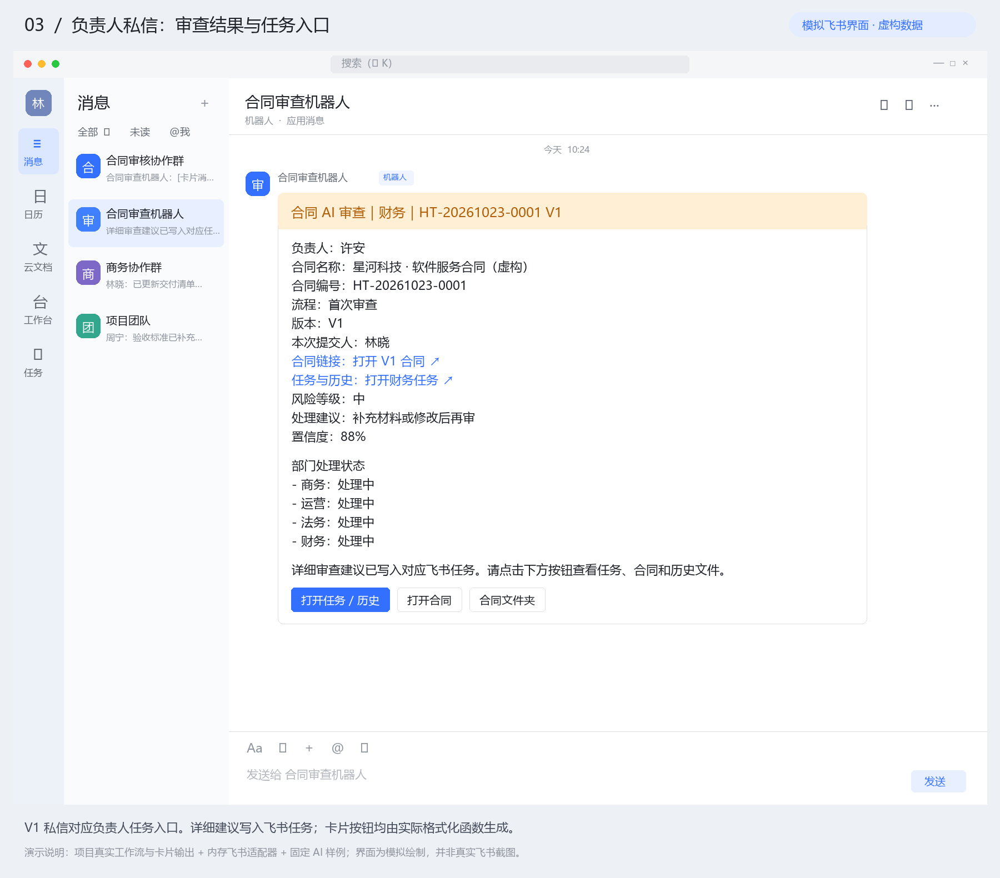

### 4. 内容未变时跳过重复审查

再次提交时重读正文并计算 hash。与上一有效审查版本一致时只发说明卡片，不增加版本、不调用模型、不重复更新任务或私信。

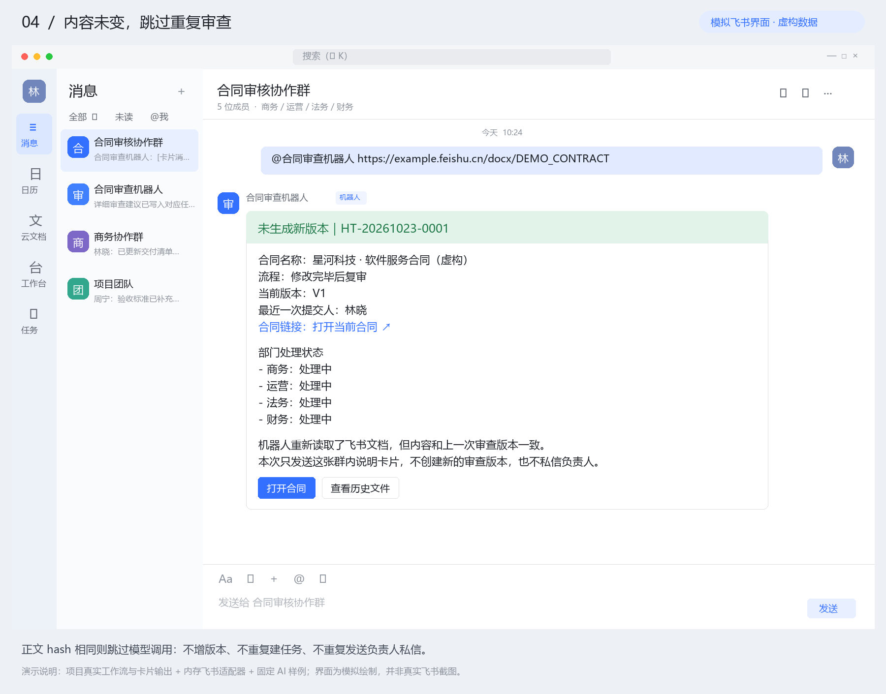

### 5. 修改后复审与版本追踪

修改同一在线文档后再次发送链接，自动进入 V2、V3 复审；也可发送 `修改完毕 + 链接`。更新群总览并复用原职能任务。普通附件在同群按规范化文件名关联，命名应稳定，避免不同合同同名。

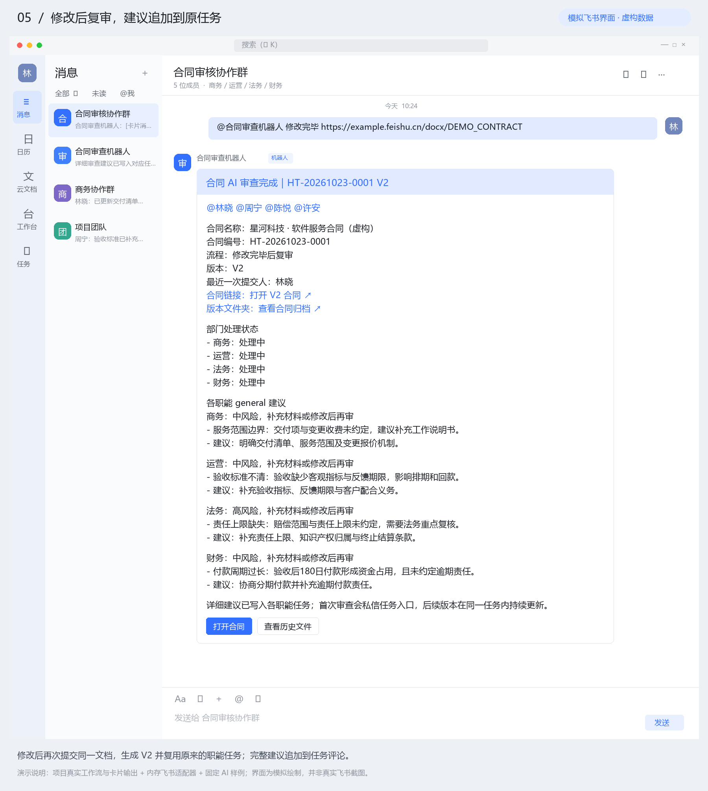

### 6. 每职能一个任务，评论保留历史

每份合同最多维护四个职能任务。V2 以后把完整建议追加到原任务评论并更新摘要，正常情况下不重复私信正式负责人。任务写入失败时，对受影响职能发送补偿卡片。

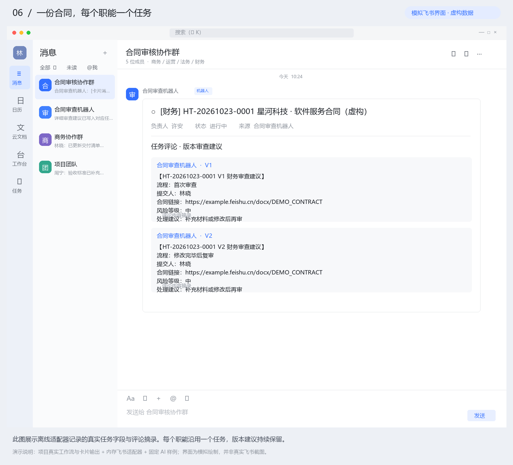

### 7. 负责人确认完成

`@合同审查机器人 HT-20261023-0001 财务已完成`，或回复合同卡片发送 `@合同审查机器人 财务已完成`。仅该职能负责人可操作。完成后关闭任务，后续版本暂停该职能的任务更新与负责人提醒，群卡片同步状态。

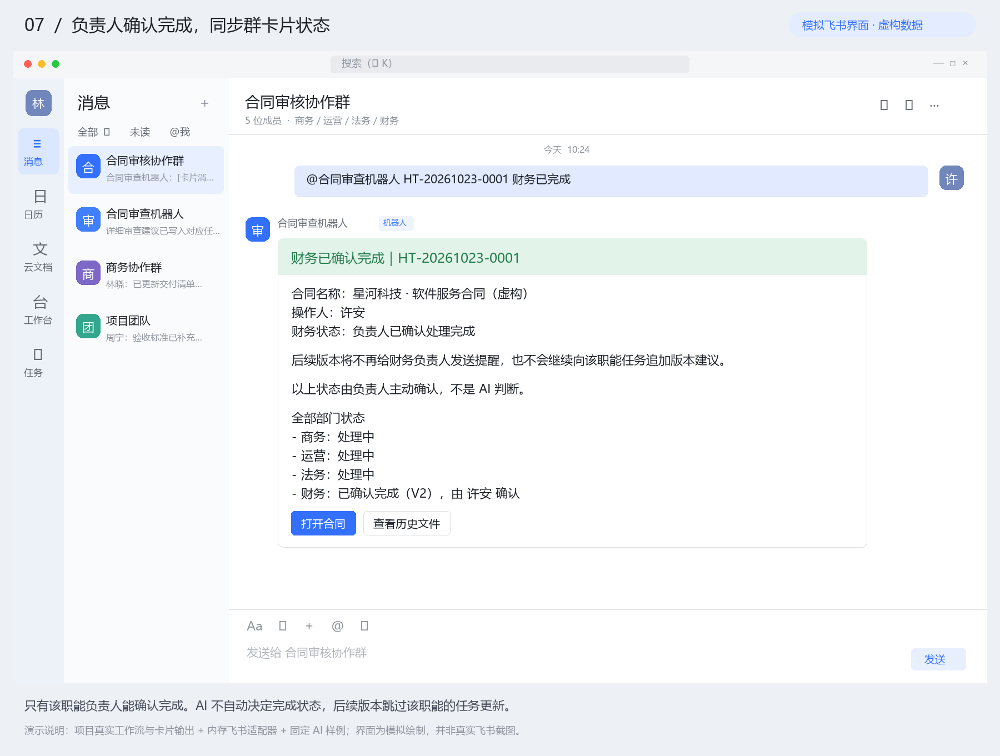

### 8. 恢复处理

`@合同审查机器人 HT-20261023-0001 财务恢复处理` 重新打开任务，参与后续版本。AI 不替负责人自动完成或恢复任务。

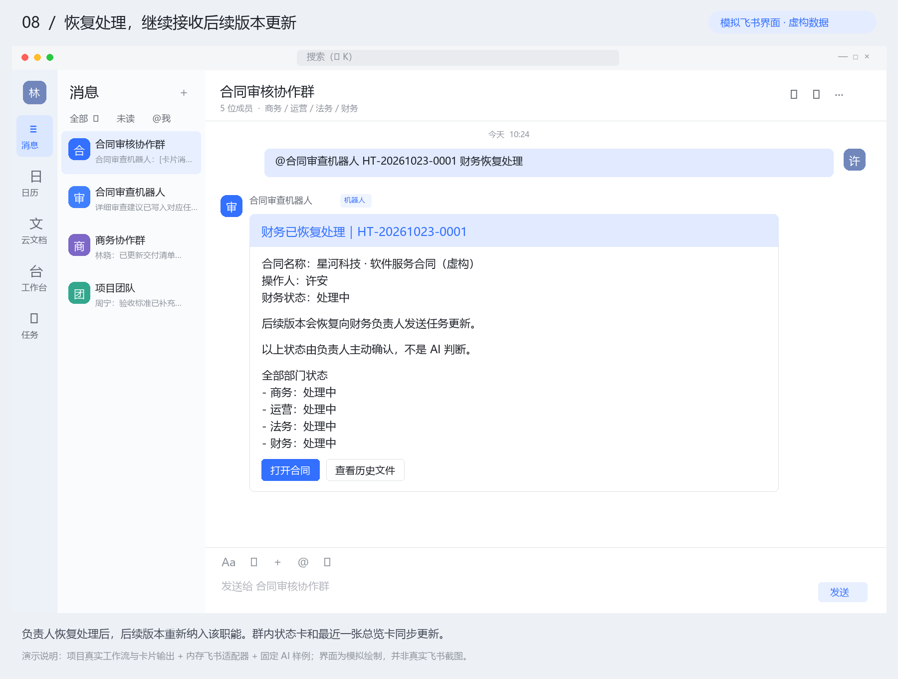

### 9. 回复普通文件附件

上传合同附件后回复文件消息并 `@机器人`。可抽取文字的 DOCX、TXT、Markdown、HTML 与部分文字型 PDF 支持基础审查。**普通附件不转换成在线文档，也不生成“打开合同”跳转按钮。** 旧版 DOC 请先另存为 DOCX；扫描件、图片与复杂编码 PDF 暂不支持。

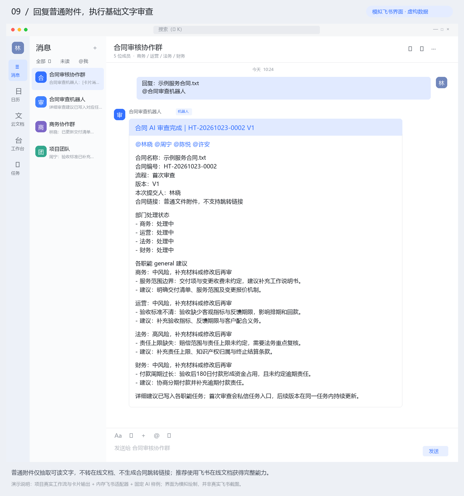

### 10. 在线文档归档与快照

启用归档时按群建立“合同”文件夹，每份在线合同建立子文件夹和原文档快捷方式；`docx` 每次有效审查创建版本快照。归档权限不足时继续审查并给出提示。旧版 `docs` 不生成 docx 快照。

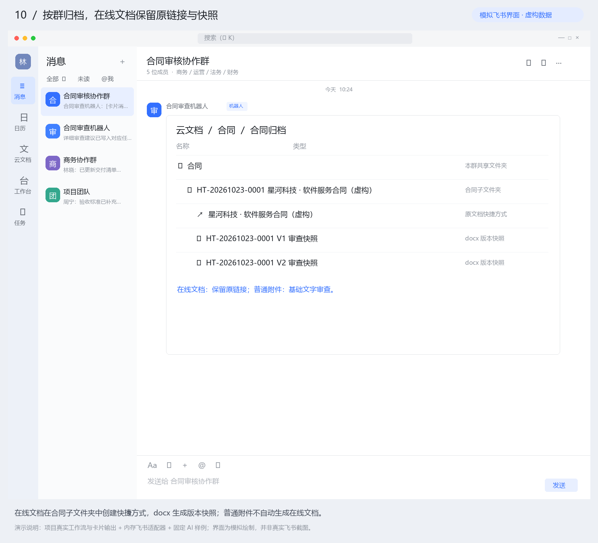

### 11. 清理本地审查记录

`@合同审查机器人 删除记录 + 飞书文档链接` 清除本地记录，下次按新合同处理。不会删除原飞书文档。当前命令向目标群成员开放，请在受控群使用并先备份状态。

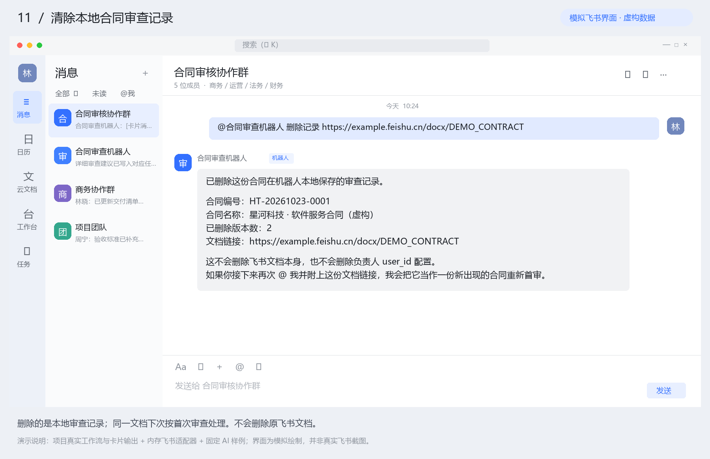

## 支持范围

| 输入 / 能力 | 当前行为 |
| --- | --- |
| 飞书 docx / docs / wiki | 原链接、首审、复审、职能任务 |
| 回复含文档链接的消息 | 从被回复消息解析链接 |
| DOCX / TXT / Markdown / HTML | 本地抽取文字；HTML 未做完整页面渲染 |
| 文字型 PDF | 基础抽取，复杂字体、编码和布局可能无法识别 |
| 旧版 DOC、扫描 PDF、图片 | 请转成 DOCX 或飞书在线文档 |
| 附件转在线文档 | 聊天主流程不调用；底层导入 API 保留供诊断与扩展 |
| 审查规则 | 服务方视角，临床／服务合同参考清单，可定制 |
| 模型服务 | OpenAI-compatible Chat Completions；兼容 ARK 与旧变量 |
| 状态存储 | 本地 JSON，单实例；应持久化并备份 data/ |
| 已完成职能 | 不再更新任务和提醒；现有模型层仍生成四职能结果 |
| 最终审批 | 由人决定，AI 只给建议 |

## 架构

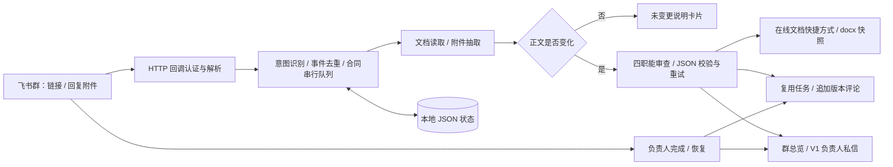

```text
src/chat/       意图、状态、附件抽取、归档、任务协调
src/feishu/     飞书 SDK、回调认证、错误翻译
src/review/     提示词、模型适配、结构校验、卡片
src/domain/     合同、版本、负责人和任务类型
.claude/skills/ 审查规则与参考清单
tests/          工作流、API 结构、迁移与 HTTP 测试
scripts/        离线演示、图片生成、诊断与维护
docs/           安装、部署、场景图、验证与来源
archive/        两个历史版本的脱敏源码和原始文档
```

## 验证与维护

| 命令 | 用途 |
| --- | --- |
| `pnpm typecheck` | TypeScript 严格类型检查 |
| `pnpm test` | 编码、构建、五组回归与 HTTP 测试 |
| `pnpm demo` | 无密钥的 11 场景工作流演示 |
| `python scripts/render-scenes.py` | 从演示 JSON 生成 PNG；需 Pillow 和中文字体 |
| `pnpm diagnose` | 配置、权限、回调诊断，需真实配置 |
| `pnpm verify:live` | 显式启用的真实 API 检查，见验证记录 |
| `pnpm tasks:backfill` | 权限修复后补建历史任务，会修改飞书数据 |

GitHub Actions 在 Linux / Windows、Node.js 22 / 24 上执行安装、类型检查、测试与演示。真实 API 和消息发送不属于 CI。

本仓库由三个桌面版本整理，最新版为主线，前两版保留于 `archive/`。修正了旧文档中附件自动导入与 PDF 支持等过期描述，并补上独立的 Webhook Token 校验。当前按可构建、离线流程可复现验收，**不宣称线上飞书全链路已验证**。详见 [验证记录](docs/VERIFICATION.md)、[版本来源](docs/PROVENANCE.md)、[贡献指南](CONTRIBUTING.md) 和 [安全说明](SECURITY.md)。
