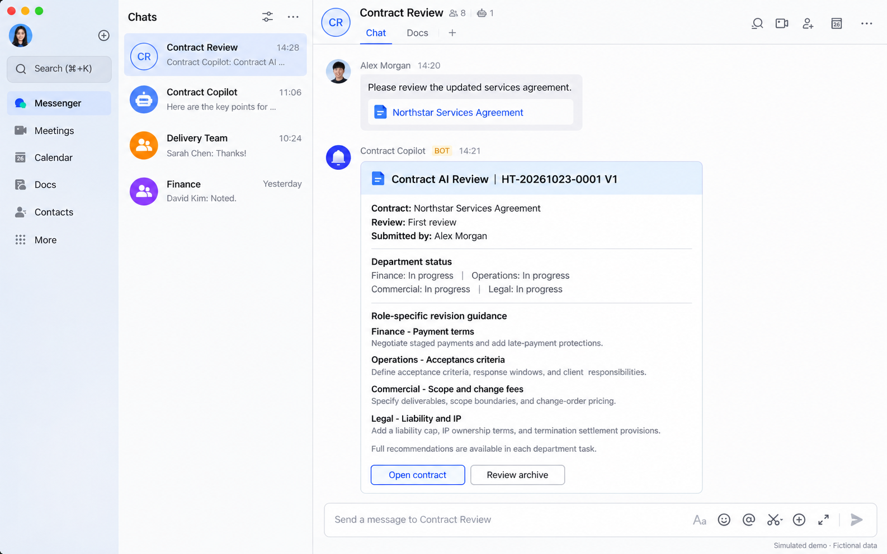
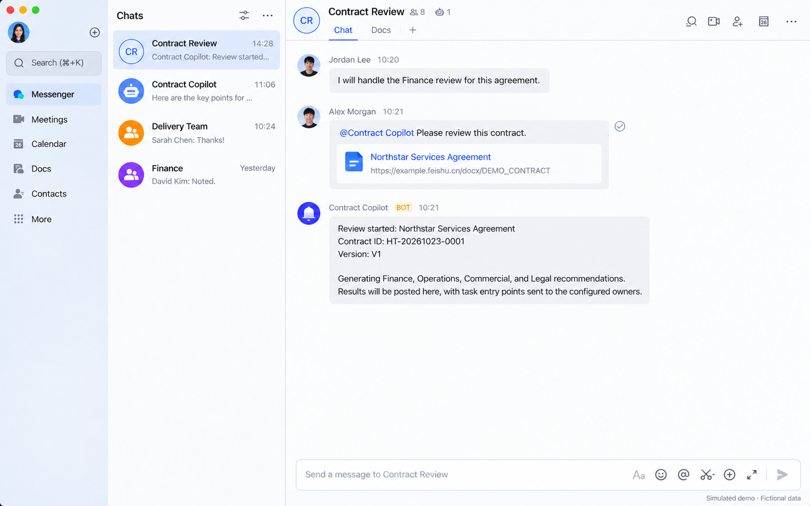
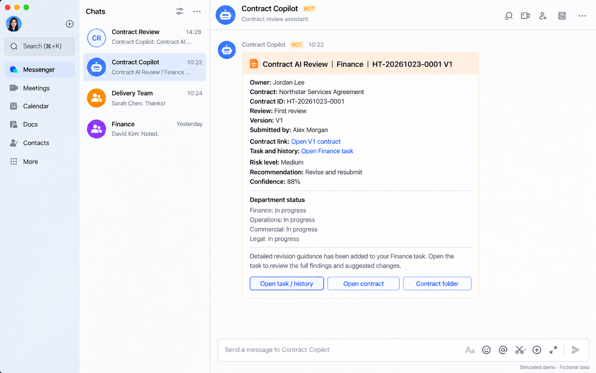
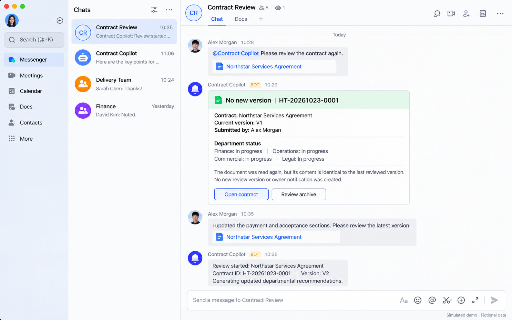
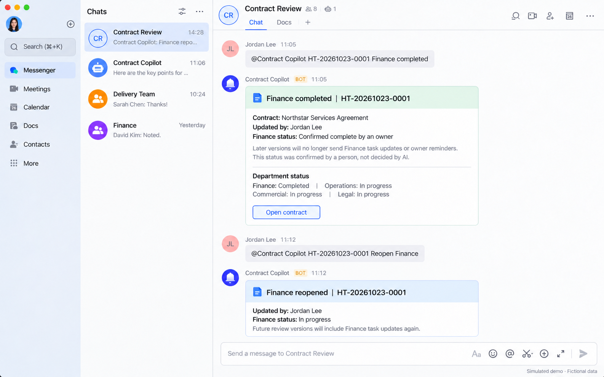
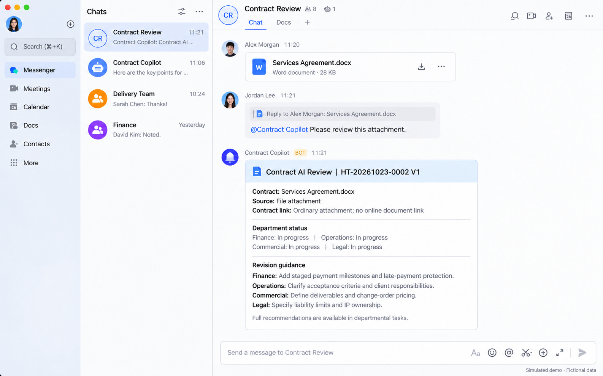
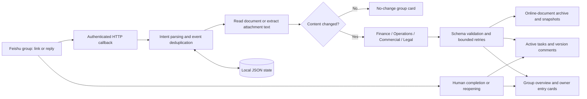

# Cross-Functional Contract Copilot

**One contract. Role-specific revision guidance. Shared follow-through.**

[](https://github.com/ericli-88/cross-functional-contract-copilot/actions/workflows/ci.yml)


An event-driven TypeScript assistant that helps **Finance, Operations, Commercial, and Legal** review the **same contract from their respective functional perspectives**. It turns a document shared in a Feishu group into structured risk findings, suggested contract revisions, departmental follow-up tasks, and version-aware re-review.

The focus is the handoff from **“what should change in this contract?”** to **“who needs to act on it, and what happened in the next revision?”**



> **Demo disclosure:** All figures are English-localized simulated Feishu desktop screenshots, created with official client references and fictional contract-bot conversations. They are not live execution captures. The runtime has not been translated into English.

[Try the offline workflow](#run-the-offline-workflow) · [Complete capability inventory](docs/CAPABILITIES.md) · [Setup](docs/SETUP.md) · [Verification](docs/VERIFICATION.md) · [Architecture](#architecture)

## What each function receives

Each role produces its own structured result: contract category, risk level, recommendation, confidence, specific concerns, proposed actions, and reviewer reminders. Findings are advisory; the bot does not rewrite the source contract or grant final approval.

| Function | Current review focus | Example revision guidance from the fictional demo |
| --- | --- | --- |
| **Finance** | Payment milestones, payment cycles, retainage, invoice/payment separation, late-payment protection | Negotiate staged payments and add late-payment protections. |
| **Operations** | Delivery feasibility, scope boundaries, change fees, client responsibilities, acceptance criteria | Define acceptance criteria, response windows, and client responsibilities. |
| **Commercial** | Delivery feasibility, scope boundaries, change fees, client responsibilities, acceptance criteria | Specify deliverables, scope boundaries, and change-order pricing. |
| **Legal** | Balanced obligations, liability caps, intellectual property, data boundaries, termination and disputes | Add a liability cap, IP ownership terms, and termination settlement provisions. |

**Implementation accuracy:** Commercial and Operations are separate review calls and recipient groups, but currently share the same checklist and focus areas. Different demo examples illustrate possible outputs; they do not establish distinct underlying policies.

## From submission to follow-up

### 1. Submit a contract in the group

Mention the bot with a Feishu `docx`, legacy `docs`, or `wiki` link. It can also resolve document links and supported attachments from a replied-to message. The group receives a role summary and the original document link.



### 2. Deliver actionable guidance to the right owners

The first review sends each configured owner a role card and task entry point. Detailed findings and revision actions live in task comments. A role can have multiple owners. Subsequent versions update the existing active role task rather than creating a task per version; normal owner DMs are suppressed after V1 when task synchronization succeeds.



### 3. Review revisions without repeating unchanged work

Submitting an existing document again re-reads its content. Identical content produces a no-change card and skips AI review, new version creation, task updates, and owner DMs. Changed content becomes V2, V3, and so on, with new recommendations appended to active task comments.



### 4. Keep department status under human control

Configured owners can mark a department complete or reopen it, using a contract ID, document link, or related message. The bot records the actor and updates the group status card. AI never marks work complete.

**Current lifecycle:** completion deletes the associated role task and its local task mapping. Reopening changes the department status; a replacement task is created on the next changed-content review. Historical AI results remain in local version records, but task-comment history is not guaranteed to survive task deletion. Any configured owner may update a department, not only that department's owner.



### 5. Make input and archive behavior explicit

Online documents retain their original URL. With archiving enabled, the bot creates a per-group folder, a contract subfolder and shortcut, and version snapshots for `docx`. Ordinary attachments support basic text extraction; they are not automatically converted to online documents or given contract-opening links.



## Capability checklist

The [full inventory](docs/CAPABILITIES.md) maps each capability to its implementation and current boundary.

- **Intake:** mentions, rich-text links, replied messages, `docx` / `docs` / `wiki`, DOCX and text attachments, basic text-PDF extraction.
- **Review:** four role-scoped calls, inline reference checklists, structured JSON validation, risk findings, proposed contract changes, retries and model-specific repair paths.
- **Ownership:** environment defaults, chat registration, multiple configured owners, user-ID routing, missing-owner guidance, optional deduplicated test CC.
- **Collaboration:** group summaries, V1 private entry cards, reusable active tasks, per-version comments, delivery-failure fallback, human completion and reopening.
- **Versioning:** contract IDs, content hashes, no-change skips, failed-version retry handling, source aliases, online-document shortcuts and `docx` snapshots.
- **Backend reliability:** event deduplication, per-contract serialization, bounded review concurrency, local JSON persistence with atomic replacement, legacy-state migration, authenticated HTTP callbacks, health checks, diagnostic and task-backfill scripts.

## Run the offline workflow

Use Node.js **22 or 24** and **pnpm 11.9.0**. No Feishu credentials, model key, or paid API calls are needed for tests and the offline demo.

```sh
git clone https://github.com/ericli-88/cross-functional-contract-copilot.git
cd cross-functional-contract-copilot
pnpm install --frozen-lockfile
pnpm typecheck
pnpm test
pnpm demo
```

The demo executes the real workflow against in-memory Feishu and deterministic review adapters. It verifies **11 scenarios**, including first review, duplicate-content detection, re-review, task reuse, status changes, attachments, archiving, and local-record reset. It exports raw workflow cards and an English documentation view to `docs/demo/`.

The figures use reference-guided ImageGen editing to preserve the real client layout. See [Screenshot provenance and prompts](docs/design/SCREENSHOTS.md). To verify the committed assets without redrawing them, run:

```sh
python scripts/verify-screenshots.py
```

## Connect to Feishu

Copy `.env.example` to `.env`, supply your own app credentials and an OpenAI-compatible model endpoint, then run:

```sh
pnpm build
pnpm start
```

The default port is `3000`; `GET /healthz` returns `{"ok":true}`. Configure an HTTPS callback at `/feishu/events`, subscribe to `im.message.receive_v1`, publish the required app permissions, and add the bot to the target group. Full configuration, permission identifiers, and runtime-language details are in [Setup](docs/SETUP.md).

## Architecture



| Area | Engineering approach |
| --- | --- |
| Application | Express HTTP service and the official Feishu Node SDK |
| Review orchestration | Four role-scoped model calls; concurrency limited to two roles at a time; no autonomous multi-agent planner |
| Model boundary | OpenAI-compatible Chat Completions, typed result schema, JSON validation and repair |
| State | Contracts, source identities, versions, hashes, owners, task mappings and processed events in local JSON |
| Reliability | Same-contract work is serialized; duplicate events and unchanged content are handled separately |
| Validation | Workflow, SDK request-contract, state migration and real local HTTP tests; Windows/Linux CI on Node 22/24 |

## Current boundaries

- No automatic contract redlining, tracked changes, e-signatures, or final approval.
- No OCR for scans or images. Legacy `.doc` needs conversion; PDF extraction is basic and can fail on complex fonts or layouts. HTML is read as text rather than rendered as a page.
- The deployment's commands, cards, and model output are primarily Chinese. English figures are localized documentation, not evidence of English runtime support.
- Shared Commercial/Operations criteria, cross-role owner authorization, and task deletion on completion are current implementation choices, not stronger controls.
- Local storage is designed for one application instance. It is not a multi-replica database or an immutable audit log.
- Archiving can change document sharing to organization-editable and grant group folder access. Review your organization's data policy before enabling it.
- The reference material is a service-provider-oriented clinical/services checklist library; this project does not claim U.S.-specific legal compliance or validated legal advice.
- Tests and demos establish offline behavior. Live model quality, tenant permissions, production deployment, and business impact are not claimed as verified outcomes.

See [Verification](docs/VERIFICATION.md), [Security](SECURITY.md), [Contributing](CONTRIBUTING.md), and [Version provenance](docs/PROVENANCE.md). Earlier source versions are retained in [`archive/`](archive/) for reference; the current public-facing documentation is English.
